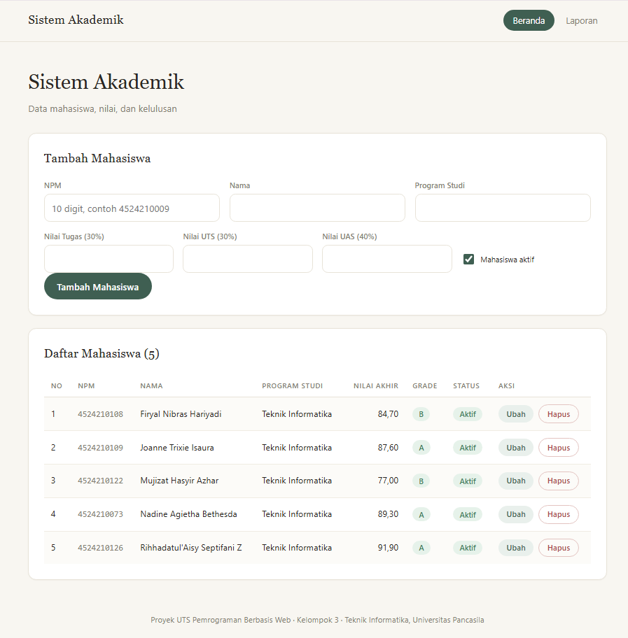

<div align="center">

  <h2> UTS PROJECT PEMROGRAMAN BERBASIS WEB</h2>
  <p>
    <i>"Sistem Akademik "<br>
    </i>
  </p>

  <br>


  <br><br>

  <h3>Disusun Oleh :</h3>

  <table>
    <tr>
      <td>Nadine Agietha Bethesda</td>
      <td>4524210073</td>
    </tr>
    <tr>
      <td>Firyal Nibras Hariyadi</td>
      <td>4524210108</td>
    </tr>
    <tr>
      <td>Joanne Trixie Isaura </td>
      <td>4524210109</td>
    </tr>
    <tr>
      <td>Mujizat Hasyir Azhar</td>
      <td>4524210122</td>
    </tr>
    <tr>
      <td>Rihhadatul'Aisy Septifani Z</td>
      <td>4524210126</td>
    </tr>
  </table>

  <br><br>

  <h3>Dosen Pengampu</h3>
  <p>Ari Wibowo, S.Kom., M.Kom., C. Pro</p>
  <br><br>

  <h2>PROGRAM STUDI TEKNIK INFORMATIKA<br>
  UNIVERSITAS PANCASILA<br>
  2026</h2>

</div>

# Penjelasan Proyek Sistem Akademik

## 1. Studi Kasus
Proyek ini merupakan aplikasi berbasis web sederhana untuk memenuhi Tugas Project UTS Mata Kuliah Pemrograman Berbasis Web Kelompok dari pertemuan 1-7. Sistem ini dirancang untuk melakukan proses pendataan dan perhitungan nilai akhir mahasiswa. Database aplikasi ini menyimpan beberapa field, yaitu:
<ul>
  <li><b>NPM</b> (Nomor Pokok Mahasiswa)</li>
  <li><b>Nama Mahasiswa</b></li>
  <li><b>Program Studi</b></li>
  <li><b>Nilai Tugas</b></li>
  <li><b>Nilai UTS</b> (Ujian Tengah Semester)</li>
  <li><b>Nilai UAS</b> (Ujian Akhir Semester)</li>
  <li><b>Status Aktif</b> (Aktif/Cuti/Tidak Aktif)</li>
  <li><b>Nilai</b> (Nilai akhir hasil perhitungan dari komponen tugas, UTS, dan UAS)</li>
</ul>

<hr>

## 2. Pembagian Tugas
<table border="1" cellpadding="8" cellspacing="0">
  <tr>
    <th>Nama Anggota</th>
    <th>Tugas / Tanggung Jawab</th>
  </tr>
  <tr>
    <td>Rihhadatul'Aisy Septifani Z</td>
    <td>Koordinator/System Analyst: Menyusun alur, membagi tugas, memastikan seluruh kompetensi P1–P7 terpenuhi. </td>
  </tr>
  <tr>
    <td>Firyal Nibras Hariyadi</td>
    <td>PHP Developer A: Fokus procedural, function, variabel, operator, string.</td>
  </tr>
  <tr>
   <td>Mujizat Hasyir Azhar</td>
    <td>PHP Developer B: Fokus OOP, class/object, perulangan, dan output tabel.</td>
  </tr>
  <tr>
    <td>Nadine Agietha Bethesda</td>
    <td>Tester & Dokumentasi: Menyusun skenario uji, screenshot, README, dan laporan singkat.</td>
  </tr>
  <tr>
    <td>Joanne Trixie Isaura </td>
    <td>Presenter / UI Integrator: Merakit halaman, navigasi, presentasi, dan demo akhir.</td>
  </tr>
</table>

## 3. Penjelasan Fitur
Aplikasi Sistem Akademik ini memiliki **5 fitur utama**:

### 3.1. Tambah Data Mahasiswa
Pengguna dapat menambahkan data mahasiswa baru melalui form di halaman utama (`index.php`). Data yang diinput meliputi:
- NPM
- Nama
- Program Studi
- Nilai Tugas, UTS, UAS
- Status Aktif

Data kemudian diproses di `proses.php`, divalidasi (NPM 10 digit angka, nilai 0-100), lalu disimpan ke tabel `mahasiswa` di database.

### 3.2. Ubah Data Mahasiswa
Pengguna dapat mengubah data mahasiswa yang sudah ada dengan menekan tombol **"Ubah"** di tabel daftar mahasiswa. Form di halaman utama akan otomatis terisi dengan data lama. Setelah diubah, data diproses di `proses.php` dan diperbarui di database berdasarkan NPM lama.

### 3.3. Hapus Data Mahasiswa
Pengguna dapat menghapus data mahasiswa dengan menekan tombol **"Hapus"**. Akan muncul dialog konfirmasi (`confirm()`) sebelum data benar-benar dihapus dari database untuk mencegah penghapusan yang tidak disengaja.

### 3.4. Lihat Laporan
Halaman `laporan.php` menampilkan rekap nilai dan kelulusan seluruh mahasiswa, meliputi:
- **Statistik:** Total mahasiswa, jumlah mahasiswa aktif, jumlah lulus, dan rata-rata nilai akhir.
- **Ringkasan Nilai:** Nilai tertinggi, nilai terendah, batas kelulusan, dan persentase kelulusan.
- **Tabel Nilai Lengkap:** Menampilkan NPM, Nama, Nilai Tugas/UTS/UAS, Nilai Akhir, Grade, Kelulusan, dan Status.
  ---

## 4. Implementasi Konsep PHP

Proyek ini mengimplementasikan 8 konsep dasar PHP di berbagai file:

| No | Konsep | File | Implementasi |
| :--- | :--- | :--- | :--- |
| 01 | **Data** | `functions.php`, `akademikproject.sql` | Tipe data string (NPM), float (nilai), boolean (status aktif), dan array (daftar mahasiswa). |
| 02 | **Function** | `functions.php` | `hitungNilaiAkhir()` untuk hitung nilai akhir, `tentukanGrade()` untuk konversi ke grade A-E. |
| 03 | **Class** | `classes/mahasiswa.php` | Class `Mahasiswa` dengan properti dan method (`hitungNilai`, `getGrade`, `getKelulusan`). |
| 04 | **Operator** | `functions.php`, `index.php`, `proses.php` | Aritmetika (`*`, `+`), perbandingan (`>=`), logika (`||`, `&&`), ternary (`? :`), modulus (`%`). |
| 05 | **String** | `functions.php` | `trim()`, `strtolower()`, `ucwords()`, `strlen()`, `htmlspecialchars()`, `number_format()`. |
| 06 | **WHILE** | `functions.php`, `laporan.php` | `koreksiNilai()` untuk validasi nilai 0-100, dan perhitungan rekap di laporan. |
| 07 | **DO-WHILE** | `functions.php`, `laporan.php` | `bersihkanNpm()` untuk membersihkan NPM dari spasi, dan pengecekan kesiapan data laporan. |
| 08 | **FOR** | `index.php`, `laporan.php`, `proses.php` | Menampilkan daftar mahasiswa dalam tabel dan rincian perhitungan nilai. |

### Cuplikan Kode

**01. Data (Konversi Tipe Data) — `functions.php`**
```php
function barisKeObjek($row)
{
    $npm   = (string) $row["npm"];         // string
    $tugas = (float)  $row["nilai_tugas"]; // float
    $aktif = (bool)   $row["status_aktif"];// boolean

    return new Mahasiswa($npm, $row["nama"], $row["program_studi"],
                         $tugas, $uts, $uas, $aktif);
}
```

**02. Function (Perhitungan Nilai) — `functions.php`**
```php
function hitungNilaiAkhir($tugas, $uts, $uas)
{
    $hasil = ($tugas * BOBOT_TUGAS) + ($uts * BOBOT_UTS) + ($uas * BOBOT_UAS);
    return round($hasil, 2);
}

function tentukanGrade($nilai)
{
    if ($nilai >= 85)      return "A";
    elseif ($nilai >= 75)  return "B";
    elseif ($nilai >= 60)  return "C";
    elseif ($nilai >= 50)  return "D";
    else                   return "E";
}
```

**03. Class (OOP) — `classes/mahasiswa.php`**
```php
class Mahasiswa
{
    public $npm, $nama, $prodi, $tugas, $uts, $uas, $aktif;

    public function __construct($npm, $nama, $prodi, $tugas, $uts, $uas, $aktif)
    {
        $this->npm   = $npm;
        $this->nama  = $nama;
        $this->prodi = $prodi;
        $this->tugas = $tugas;
        $this->uts   = $uts;
        $this->uas   = $uas;
        $this->aktif = $aktif;
    }

    public function hitungNilai()
    {
        return hitungNilaiAkhir($this->tugas, $this->uts, $this->uas);
    }
}
```

**04. Operator (Aritmetika, Perbandingan, Ternary, Modulus) — `functions.php`, `index.php`**
```php
// Aritmetika & perbandingan
$hasil = ($tugas * 0.30) + ($uts * 0.30) + ($uas * 0.40);
if ($nilai >= 85) { ... }

// Logika ||
if ($grade == "A" || $grade == "B") { ... }

// Ternary
return $this->hitungNilai() >= BATAS_LULUS ? "Lulus" : "Tidak Lulus";

// Modulus (baris genap)
<tr class="<?= $i % 2 == 0 ? 'baris-genap' : '' ?>">
```

**05. String (Trim, Ucwords, Number Format) — `functions.php`**
```php
function rapikanNama($nama)
{
    $nama = trim($nama);
    $nama = strtolower($nama);
    return ucwords($nama, " '-");
}

function formatNilai($angka)
{
    return number_format($angka, 2, ",", ".");
}
```

**06. WHILE (Validasi Nilai) — `functions.php`**
```php
function koreksiNilai($nilai)
{
    while ($nilai < NILAI_MIN || $nilai > NILAI_MAX) {
        if ($nilai < NILAI_MIN) $nilai = NILAI_MIN;
        else                    $nilai = NILAI_MAX;
    }
    return $nilai;
}
```

**07. DO-WHILE (Pembersihan NPM) — `functions.php`**
```php
function bersihkanNpm($npm)
{
    $percobaan = 0;
    do {
        $percobaan++;
        if ($percobaan == 1) $npm = trim($npm);
        else                 $npm = str_replace(" ", "", $npm);
    } while (strlen($npm) != PANJANG_NPM && $percobaan < 3);

    return $npm;
}
```

**08. FOR (Menampilkan Tabel) — `index.php`**
```php
<?php for ($i = 0; $i < $total; $i++): ?>
    <?php $m = $daftar[$i]; ?>
    <tr>
        <td><?= $i + 1 ?></td>
        <td><?= escapeHtml($m->npm) ?></td>
        <td><?= formatNilai($m->hitungNilai()) ?></td>
    </tr>
<?php endfor; ?>
```

## 5. Bukti Hasil (Screenshot)

Berikut adalah screenshot hasil aplikasi Sistem Akademik:

### 5.1. Halaman Utama
Menampilkan form tambah mahasiswa dan daftar mahasiswa.



### 5.2. Fitur Utama (Tambah Data)
Proses menambahkan data mahasiswa baru.


### 5.3. Output Loop (Daftar Mahasiswa)
Hasil perulangan `for` yang menampilkan daftar mahasiswa dalam tabel.


### 5.4. Testing Validasi
Uji coba validasi input (NPM salah, nilai di luar 0-100).


### 5.5. Halaman Laporan
Rekap nilai dan statistik kelulusan seluruh mahasiswa.


---

## 6. Kendala dan Solusi
